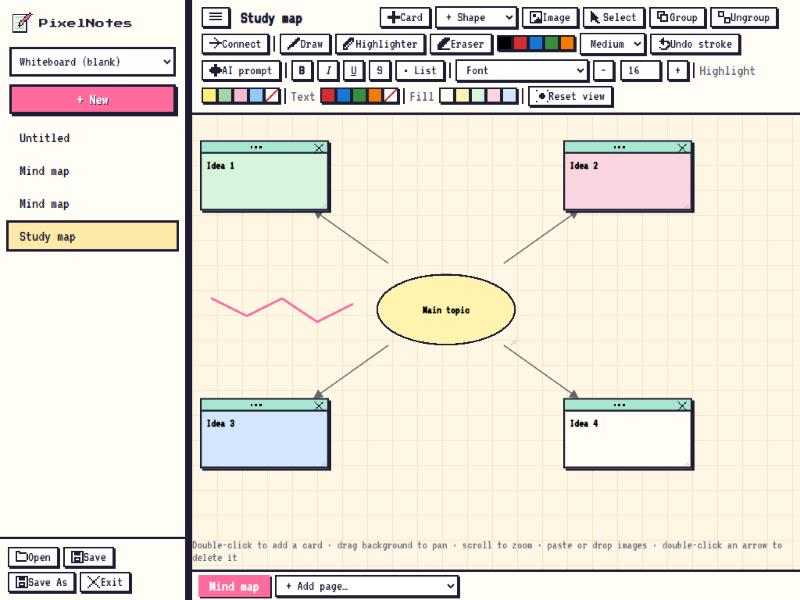
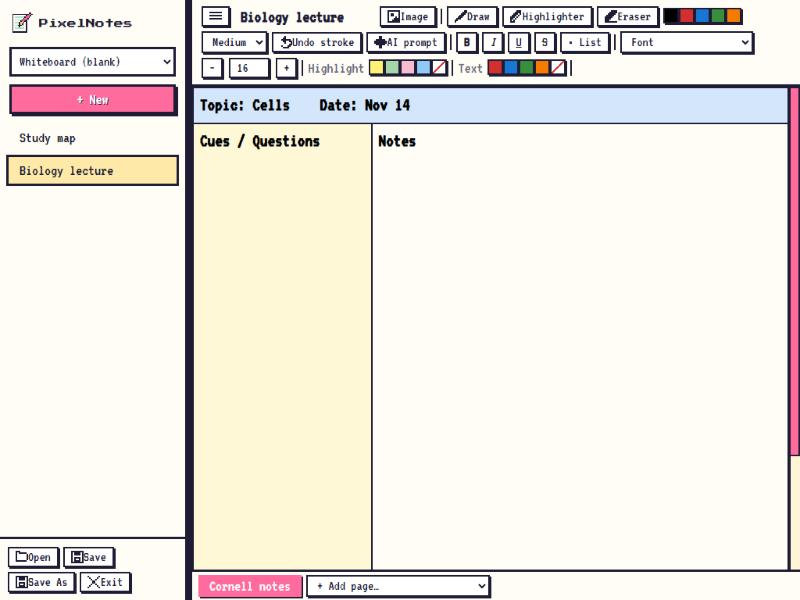

# PixelNotes

A pixel-art whiteboard and note-taking app. Sketch ideas on an infinite canvas, write notes in classic note-taking layouts, and keep everything in your own browser. Free and open source.

**Try it:** https://bobagart.github.io/PixelNotes/





## Features

- **Infinite whiteboard** with cards, shapes, images, arrows, freehand drawing and an eraser.
- **Select, group and ungroup** items; grouped items move together.
- **Note-taking pages**: Cornell, Outline and Charting layouts that fill the whole page, plus a blank document.
- **Several pages per file**, each its own whiteboard or note-taking method.
- **Highlighter**: drag over text to highlight it.
- **Drawing controls**: stroke size, opacity, undo and redo.
- **Zoom** with the +/- buttons, a trackpad or two fingers (including Safari on iPhone, iPad and Mac).
- **Pixel fonts and pixel icons** throughout.
- **AI prompt**: turns a page into a text prompt for an AI image tool (built locally, nothing is sent anywhere).
- **Save and Save As** as Word (`.docx`), PDF, a PNG image (whiteboards) or a PixelNotes file you can open again, with an unsaved-changes prompt on Exit.
- **Works offline** once installed.
- **Phone friendly**: the toolbar scrolls sideways, the file list slides in over the canvas, and two fingers pinch to zoom the whiteboard.

## Install

PixelNotes is a web app that installs like a native one. Open the link above, then:

| Platform | How |
| --- | --- |
| Android (Chrome) | Menu, then **Install app** or **Add to Home screen** |
| iPhone / iPad (Safari) | Share, then **Add to Home Screen** |
| Windows / macOS / Linux (Chrome, Edge) | Click the install icon in the address bar |

Native installers (Windows, macOS, Linux, Android APK) are planned, see the roadmap below.

## Run it yourself

No build step and no dependencies.

```bash
git clone https://github.com/bobagart/PixelNotes.git
cd PixelNotes
python -m http.server 8000
```

Then open http://localhost:8000. The install and offline features need `http://` or `https://`; opening `index.html` directly still works for everything else.

## Your data

Notes live in your browser's local storage, so they stay on your device. **Save** offers four types:

- **Word (`.docx`)**: the current page, with text, tables, colours and pictures. A whiteboard page becomes a picture of the board plus its text.
- **PDF**: the current page through your browser's print dialog (choose **Save as PDF**), including drawings.
- **PNG image**: the current whiteboard page as a picture.
- **PixelNotes file** (`.pixelnotes`): the whole file with every page, so you can back it up or move it to another device and load it with **Open**.

Only PixelNotes files can be opened again. Open files are cleaned before they are loaded, so files from other people cannot run scripts. Fonts are loaded from Google Fonts; offline, the app falls back to a plain monospace font.

## Roadmap

- Desktop installers (Windows, macOS, Linux)
- Android APK
- iOS: use **Add to Home Screen** for now. A store app needs a paid Apple developer account.

## Contributing

Contributions are welcome. Read [CONTRIBUTING.md](CONTRIBUTING.md) first.

## License

Apache License 2.0. See [LICENSE](LICENSE) and [NOTICE](NOTICE).

Copyright 2026 Clark Adriane Ratilla. Forks and copies must keep the license and the NOTICE file, which credit the original author.
